<div align="center">


</div>

<br>
<br>

## ✨ About light-server

light-server는 light 크롬 확장 프로그램의 백엔드 API 서버입니다.

경제 뉴스 기사 본문을 받아 AI로 금융 용어를 추출하고, 정의와 예시 문장을 반환합니다.
내부 용어 사전을 우선 조회해 불필요한 API 호출을 최소화하고,
사전에 없는 용어는 Claude AI가 실시간으로 설명을 생성합니다.

<br>

## 🧩 How It Works

```mermaid
---
config:
  layout: elk
  theme: base
  elk:
    edgeRouting: ORTHOGONAL
  themeVariables:
    primaryColor: "#fbfcfd"
    primaryBorderColor: "#e6e8ea"
    fontFamily: "Pretendard, sans-serif"
    clusterBkg: "#fbfcfd"
    clusterBorder: "#d6d7da"
---
flowchart LR
    subgraph FRONT["Chrome Extension (프론트)"]
        direction TB
        A([뉴스 기사 페이지]) --> B[scanner.ts\n텍스트 수집]
        B --> C{API 키\nchrome.storage 확인}
        C -->|키 없음 · 체험용| D[(terms.json\n로컬 용어 조회)]
        C -->|키 있음 · 풀 기능| E[POST /api/extract]
    end

    subgraph BACK["light-server (백엔드 · Node.js/Express)"]
        direction TB
        F{x-api-key\n유효성 검사}
        F -->|키 없음| G[401 Unauthorized]
        F -->|키 있음| H[Claude API\n금융 용어 추출]
        H --> I{terms.json\n등록 여부}
        I -->|등록된 용어| J[기존 description\n+ example 반환]
        I -->|미등록 용어| K[Claude API\n설명 + 예시 생성]
        J & K --> L[응답 조합]
    end

    E --> F
    L -->|terms 배열 반환| M([하이라이트 + 툴팁 표시])
    D --> M

    classDef request fill:#eff6ff,stroke:#7eb1f3,color:#004fa7
    classDef decision fill:#e0f7f9,stroke:#00b5c5,color:#004fa7
    classDef process fill:#c8e0ff,stroke:#7eb1f3,color:#004fa7
    classDef success fill:#eff6ff,stroke:#1779e1,color:#004fa7
    classDef error fill:#fff1f2,stroke:#f87171,color:#991b1b
    classDef storage fill:#f5f0ff,stroke:#ab8be3,color:#4a1d96

    class A,B,E request
    class C,F,I decision
    class H,J,K process
    class L,M success
    class G error
    class D storage
```



<br>

## 📡 API Reference

### POST /api/extract

**Request**

| 위치   | 키          | 설명                          |
| ------ | ----------- | ----------------------------- |
| Header | `x-api-key` | 사용자 Claude API 키 (필수)   |
| Body   | `text`      | 뉴스 기사 본문 (string, 필수) |

**Response**

```json
{
  "terms": [
    {
      "name": "PER",
      "description": "주가를 주당순이익으로 나눈 밸류에이션 지표.",
      "example": "삼성전자의 PER이 15배로 업종 평균보다 낮게 거래되고 있다."
    }
  ]
}
```

**Error**

| 코드  | 사유                              |
| ----- | --------------------------------- |
| `400` | `text` 필드 누락 또는 잘못된 타입 |
| `401` | `x-api-key` 헤더 누락             |

<br>

## 🚀 Getting Started

```bash
npm install
npm start              # 프로덕션
npm run dev            # 개발 (파일 변경 감지)
```

**배포**

Railway로 운영 중입니다.

```
https://light-server-production-d1fd.up.railway.app
```

> Claude API 키는 서버에 저장하지 않습니다.
> 클라이언트가 `x-api-key` 헤더로 직접 전달합니다.

<br>

## 🛠 Tech Stack

- Node.js + Express 5
- Claude API (Anthropic) — Haiku 4.5
- ES Modules

<br>

## 📁 Project Structure

```
src/
├── app.js               # Express 앱 설정
├── routes/
│   └── extract.js       # POST /api/extract
├── services/
│   ├── claudeService.js # 2단계 AI 처리
│   └── termService.js   # terms.json 조회
└── data/
    └── terms.json       # 내부 용어 사전
```

<br>

<div align="center">


<sub>© 2026 light. All rights reserved.</sub>

</div>
